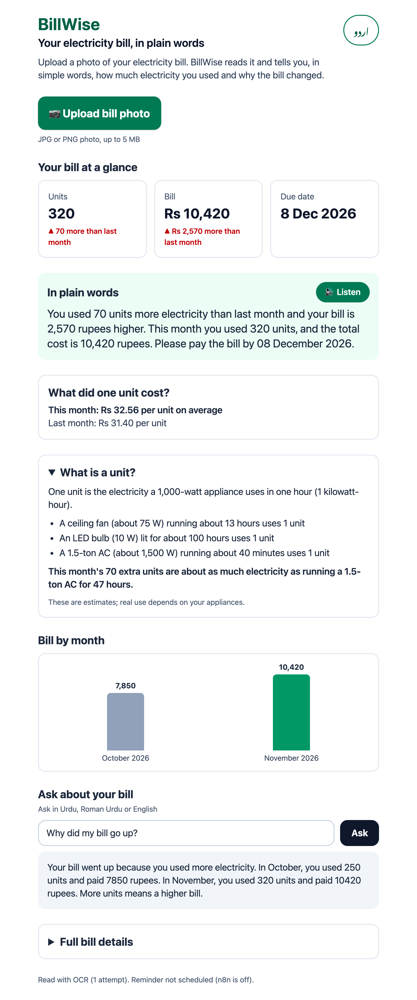

# BillWise

**بجلی کا بل، آسان زبان میں** · Your electricity bill, in plain words.

Many Pakistani households, especially older people, can't tell from a bill how much electricity they used or why it went up. BillWise reads a photo of the bill (English + Urdu labels), checks the numbers, compares with last month, and explains the change **in simple Urdu** (or English): how many more units, how many more rupees, what one unit cost, and when to pay. A listen button reads the explanation aloud.

| Urdu (default) | English | Phone |
|---|---|---|
|  |  |  |

### What a household sees

- **At a glance:** three large cards for units, bill and due date, each with "▲ 70 more than last month".
- **In plain words:** 2–3 sentences in everyday Urdu, with no percentages and no jargon, e.g. "آپ نے پچھلے مہینے کے مقابلے میں 70 یونٹ زیادہ بجلی استعمال کی ہے، اس لیے آپ کا بل 2,570 روپے زیادہ ہے۔"
- **🔊 سنیں (Listen):** reads the explanation aloud with the phone's built-in voice, slightly slower than normal.
- **What did one unit cost?** The average price per unit this month vs last month, calculated in code.
- **What is a unit?** One unit equals a ceiling fan for about 13 hours; this month's extra units equal a 1.5-ton AC for about 47 hours.
- **Ask about your bill** in Urdu, Roman Urdu or English. The answer comes back in the same language.
- **اردو / English switch:** right-to-left layout and the Noto Nastaliq Urdu font for Urdu; the choice is remembered.

## How it works

```
photo ──► OpenCV cleanup ──► Tesseract OCR (eng+urd) ──► LangGraph agent
          grayscale, denoise,                              │
          deskew, threshold                                ▼
                                                   ┌──────────────┐
                              ┌──────────────────► │   extract    │  LLM: OCR text → BillFields
                              │  retry once,       └──────┬───────┘  (retry: LLM reads the photo)
                              │  vision mode              ▼
                              │                    ┌──────────────┐
                              └─── checks fail ─── │   validate   │  plain Python, no LLM
                                                   └──────┬───────┘
                                     checks pass, or      ▼  already retried (warnings kept)
                                                   ┌──────────────┐
                                                   │   compare    │  last month from Postgres, % change
                                                   └──────┬───────┘
                                                          ▼
                                                   ┌──────────────┐
                                                   │   explain    │  LLM: 2–3 plain sentences
                                                   └──────┬───────┘
                                                          ▼
                                      Postgres upsert ──► n8n webhook ──► wait until due − 3 days ──► email
```

The validate step checks: all required fields present; `units == current_reading − previous_reading`; `amount > 0`; due date after the billing month. When a check fails the graph goes back to `extract` once, this time sending the vision model the original photo. That self-correcting loop is what makes it an agent rather than one prompt.

## Which job skill each part shows

| Requirement | Where |
|---|---|
| Computer vision (OpenCV) | [backend/app/vision.py](backend/app/vision.py): grayscale, upscale, denoise, deskew, adaptive threshold |
| OCR (Tesseract) | [backend/app/ocr.py](backend/app/ocr.py): `eng+urd`, page-segmentation mode 4 |
| LLMs, prompt engineering, structured output | [backend/app/llm.py](backend/app/llm.py): local `qwen2.5vl:3b` via Ollama by default (free, no key), or GPT via the official `openai` SDK with `LLM_PROVIDER=openai` ([llm_openai.py](backend/app/llm_openai.py)); output constrained to a JSON schema from a Pydantic model; stop reasons checked |
| Agent workflow (LangGraph) | [backend/app/agent.py](backend/app/agent.py): `StateGraph` with a conditional retry edge |
| Python + FastAPI | [backend/app/main.py](backend/app/main.py): upload limits, one error shape, CORS |
| PostgreSQL | [backend/app/db.py](backend/app/db.py), [backend/schema.sql](backend/schema.sql): parameterised SQL, upsert per account-month |
| React + TypeScript + Tailwind | [frontend/src/App.tsx](frontend/src/App.tsx), [frontend/src/i18n.ts](frontend/src/i18n.ts): Urdu-first right-to-left UI with an English switch, large text for older users, browser speech, loading/empty/error/success states, chart from plain divs |
| Workflow automation (n8n) | [n8n/bill-reminder.json](n8n/bill-reminder.json): Webhook → Wait → Send Email |
| Testing | [backend/tests/](backend/tests/): 22 pytest tests, no network |

Design decisions are logged in [docs/decisions/](docs/decisions/README.md).

## Setup

Requires Docker, Python 3.12, Node 20+, Tesseract with Urdu data, and Ollama. The default setup uses no paid API and no key; GPT is optional.

```bash
# 1. Database and n8n
docker compose up -d            # Postgres on localhost:5433, n8n on localhost:5678
# Only if your database was created before the Urdu update:
docker compose exec -T db psql -U billwise -d billwise < backend/migrations/001_add_explanation_ur.sql

# 2. Tesseract + Urdu (macOS)
brew install python@3.12 tesseract
curl -fsSL -o "$(brew --prefix)/share/tessdata/urd.traineddata" \
  https://raw.githubusercontent.com/tesseract-ocr/tessdata_fast/main/urd.traineddata
tesseract --list-langs          # should list eng and urd

# 3. Local LLM (about 3.2 GB download)
brew install ollama
ollama serve &                  # or: brew services start ollama
ollama pull qwen2.5vl:3b

# 4. Backend
cd backend
python3.12 -m venv .venv
.venv/bin/pip install fastapi uvicorn python-multipart opencv-python-headless pytesseract pillow \
  langgraph ollama openai pydantic "psycopg[binary]" httpx python-dotenv pytest
cp .env.example .env
.venv/bin/uvicorn app.main:app --port 8000

# 5. Frontend (new terminal)
cd frontend
cp .env.example .env            # VITE_API_URL=http://localhost:8000
npm install
npm run dev                     # http://localhost:5173

# 6. Tests (use a fake LLM, no Ollama needed)
cd backend && .venv/bin/pytest -v

# 7. n8n workflow
docker compose exec n8n n8n import:workflow --input=/workflows/bill-reminder.json
```

Environment variables (`backend/.env`): `DATABASE_URL`, `LLM_PROVIDER` (`ollama` or `openai`), `OLLAMA_HOST`, `OLLAMA_MODEL`, `OPENAI_API_KEY` and `OPENAI_MODEL` (only for `openai`; the model must read images), `N8N_WEBHOOK_URL` (empty = no reminder), `FRONTEND_ORIGIN`. To send real emails, open n8n at http://localhost:5678, add SMTP credentials to the "Send reminder email" node, set the recipient, and activate the workflow.

Sample bills: `backend/.venv/bin/python samples/make_samples.py` regenerates `samples/bill_2026_10.png` (clean scan) and `samples/bill_2026_11.png` (tilted 2°, noisy, like a phone photo). Both are synthetic: fake company, fake account number.

## 1-minute demo script

1. **(10 s)** "Many people in Pakistan, especially older people, can't read their electricity bill. BillWise explains it in simple Urdu." Open http://localhost:5173.
2. **(15 s)** Upload `samples/bill_2026_10.png`, then `samples/bill_2026_11.png` (the tilted, noisy one). "OpenCV straightens and cleans the photo, Tesseract reads English and Urdu, and an LLM turns the text into typed fields. Python checks that units equal current minus previous reading; if not, the LangGraph agent re-reads the photo itself."
3. **(15 s)** Point at the cards and the Urdu explanation, and press **🔊 سنیں**. "70 more units, 2,570 more rupees, in words my grandmother understands. Every number is calculated in code; the LLM only puts it into words."
4. **(10 s)** Open **ایک یونٹ کیا ہے؟**: "The extra units equal 47 hours of a 1.5-ton AC."
5. **(10 s)** Type "mera bill kitna zyada aya?" in the Ask box: it answers in Urdu. Switch to English to show the same page in English.

## Measured results

Run on 2026-11-20 against the two synthetic sample bills (MacBook with Apple M5, 16 GB RAM):

| LLM | Bill | Fields correct | Attempts | Time |
|---|---|---|---|---|
| `qwen2.5vl:3b` (local, free) | Oct 2026 | 7 / 7 | 1 (OCR) | 4.0 s |
| `qwen2.5vl:3b` (local, free) | Nov 2026 (tilted 2°, noisy) | 7 / 7 | 1 (OCR) | 4.5 s |
| `gpt-4.1-mini` (OpenAI) | Oct 2026 | 7 / 7 | 1 (OCR) | 5.3 s |
| `gpt-4.1-mini` (OpenAI) | Nov 2026 (tilted 2°, noisy) | 7 / 7 | 1 (OCR) | 4.2 s |
| `gpt-4.1-mini` (OpenAI) | Nov 2026 shrunk to 560 px, JPEG quality 12 | 6 / 7 (due date read as 6 Dec, printed 8 Dec) | 2 (OCR failed the units check → vision retry) | not timed |

On the degraded photo Tesseract read the meter readings as 15069 → 15250; the units check failed, and the vision retry recovered the correct readings (15480 → 15800). Two prompt changes moved the 3B model from 0 / 2 bills on the OCR pass to 2 / 2: listing which printed label maps to which field, and giving the explanation step plain-sentence facts with every number pre-computed.

## Known limitations

- Tested on two synthetic bills only. Real bills from different distribution companies use different layouts, and Tesseract's Urdu accuracy on real phone photos is unmeasured.
- The validator checks that numbers are consistent, not that they are right: on a blurry photo the model read the due date as 6 Dec instead of 8 Dec, and nothing flagged it.
- Deskew handles up to 15° of tilt and no perspective distortion (a photo taken at an angle).
- Re-uploading a bill for the same month overwrites the earlier one (see [decision 0003](docs/decisions/0003-postgres-upsert-per-account-month.md)).
- With `LLM_PROVIDER=openai`, bill photos are sent to OpenAI and each bill costs money.
- Urdu quality depends on the provider. GPT writes natural Urdu explanations and answers. The free 3B local model's Urdu is unusable (it repeats words), so with Ollama the Urdu explanation comes from a fixed template filled with the same numbers, and the Ask box answers in English.
- The listen button needs an Urdu voice on the device. Many Android phones and iPhones have one; many desktop browsers don't, and then the page says so.
- Tariff slabs, the 200-unit "protected consumer" rule and taxes are not explained: those rules change often, and wrong tariff advice would mislead people.
- A 3B local model is less accurate than a hosted frontier model, and each call takes seconds. The validator and vision retry exist to catch its mistakes.
- No user accounts: anyone who knows an account number can list its bills.
- The n8n email node needs SMTP credentials added by hand before it sends anything.

## Next steps

- Fine-tune a YOLO model to locate the amount and readings boxes before OCR, so Tesseract reads only the regions that matter.
- Voice reminder through Vapi or Twilio as a second n8n branch.
- Deploy: backend and Postgres on a managed container host, frontend on a static host, n8n on its own instance.
