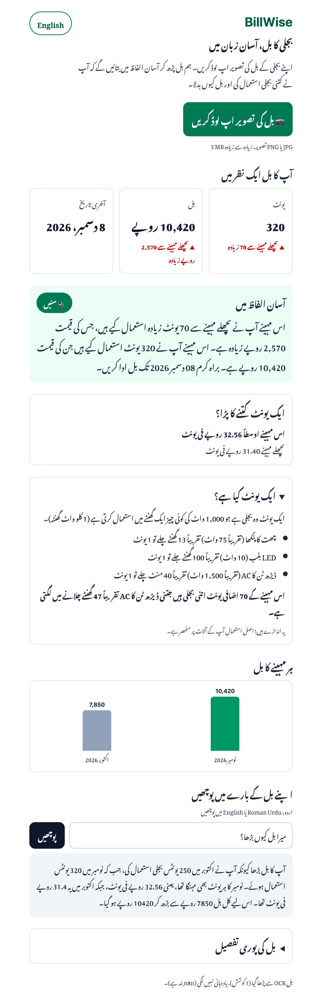
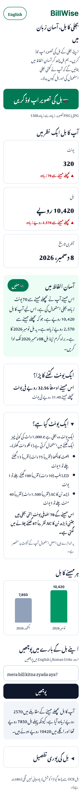

# BillWise

**بجلی کا بل، آسان زبان میں** · Your electricity bill, in plain words.

Many Pakistani households, especially older people, can't tell from a bill how much electricity they used or why it went up. BillWise reads a photo of the bill (English + Urdu labels), checks the numbers, compares with last month, and explains the change **in simple Urdu** (or English): how many more units, how many more rupees, what one unit cost, and when to pay. A listen button reads the explanation aloud.

| Urdu (default) | English | Phone |
|---|---|---|
|  |  |  |

### What a household sees

- **At a glance:** three large cards for units, bill and due date, each with "▼ 80 less than last month".
- **In plain words:** 2–3 sentences in everyday Urdu, with no percentages and no jargon, leading with the biggest reason, e.g. "آپ کے بل میں 5,000 روپے پچھلا بقایا شامل ہے۔"
- **What makes up your bill?** This month's electricity + unpaid arrears + fuel price adjustment = total, with the amount after the due date.
- **Why is your bill this amount?** Reasons found by plain Python rules, not the LLM:
  - arrears traced to the month that was only partly paid;
  - units vs last month and vs the same month last year;
  - protected / unprotected status, naming the month that crossed 200 units;
  - FPA, taxes, the late-payment amount and the subsidy.
- **Comparison from the bill itself:** on the first upload there is nothing saved to compare with, so BillWise reads the 12-month **Bill History** table printed on the bill.
- **Units by month:** a chart of that history with a dashed line at the 200-unit protected limit; months above it are red.
- **🔊 سنیں (Listen):** the server reads the explanation in a Pakistani Urdu voice (Microsoft's `ur-PK-UzmaNeural`), so it works on any phone. If the server can't, the device's own voice is used.
- **What did one unit cost?** This month's charges ÷ units, never the total with arrears.
- **What is a unit?** One unit equals a ceiling fan for about 13 hours, or a 1.5-ton AC for about 40 minutes.
- **Ask about your bill** in Urdu, Roman Urdu or English. "Why did my bill go up?" gets the concrete reasons, biggest first, in the same language.
- **اردو / English switch:** right-to-left layout and the Noto Nastaliq Urdu font for Urdu; the choice is remembered.

### Pakistani bills it understands

Pakistan has 12 electricity distribution companies (DISCOs): LESCO, IESCO, FESCO, GEPCO, MEPCO, PESCO, HAZECO, TESCO, HESCO, SEPCO, QESCO and K-Electric. The 11 government-owned ones issue bills in one format, generated by PITC (the Power Information Technology Company), with the same sections: consumer detail, meter info, charges breakdown and bill history. BillWise's prompt knows those labels in English and Urdu. K-Electric (Karachi, private) uses its own layout; it is listed in the prompt but untested.

The protected-consumer rule comes from NEPRA's 2021 tariff determination: a non-ToU household that uses 200 units or less in each of the last 6 months pays lower rates, and one month above 200 removes that for 6 months. Reports in 2026 say the government is considering changes (one-month penalty only, or a 300-unit limit); BillWise uses the 6-month rule until NEPRA changes it.

Sources: [Electricity distribution companies of Pakistan (Wikipedia)](https://en.wikipedia.org/wiki/Electricity_distribution_companies_of_Pakistan), [NEPRA TRF-100 determination, 2021](https://www.nepra.org.pk/tariff/Tariff/Ex-WAPDA%20DISCOS/2021/TRF-100%20Determination%20XWDISCOs%2023-09-2021%2037543-45.PDF), [Ministry of Energy policy guidelines, 2021](https://www.nepra.org.pk/Admission%20Notices/2021/07%20July/Policy%20guidelines%20of%20MoE.PDF), [Power Division: electricity billing](https://power.gov.pk/Detail/YThmNWQ5OGQtZGY5NC00NDk0LTgzN2MtZThhZTEzMTY5NTg2), [Business Recorder: K-Electric on protected consumers](https://www.brecorder.com/news/40318041), [Pakistan Observer: proposed end of the six-month penalty](https://pakobserver.net/?p=777578).

## How it works

```
photo ──► OpenCV cleanup ──► Tesseract OCR (eng+urd) ──► LangGraph agent
          grayscale, denoise,                              │
          deskew, threshold                                ▼
                                                   ┌──────────────┐
                              ┌──────────────────► │   extract    │  LLM: OCR text → BillFields
                              │  retry once,       └──────┬───────┘  (retry: LLM reads the photo)
                              │  vision mode              ▼
                              │                    ┌──────────────┐
                              └─── checks fail ─── │   validate   │  plain Python, no LLM
                                                   └──────┬───────┘
                                     checks pass, or      ▼  already retried (warnings kept)
                                                   ┌──────────────┐
                                                   │   compare    │  last month from Postgres, % change
                                                   └──────┬───────┘
                                                          ▼
                                                   ┌──────────────┐
                                                   │   explain    │  LLM: 2–3 plain sentences
                                                   └──────┬───────┘
                                                          ▼
                                      Postgres upsert ──► n8n webhook ──► wait until due − 3 days ──► email
```

The validate step checks: all required fields present; `units == current_reading − previous_reading`; `amount > 0`; due date after the billing month. When a check fails the graph goes back to `extract` once, this time sending the vision model the original photo. That self-correcting loop is what makes it an agent rather than one prompt.

## Which job skill each part shows

| Requirement | Where |
|---|---|
| Computer vision (OpenCV) | [backend/app/vision.py](backend/app/vision.py): grayscale, upscale, denoise, deskew, adaptive threshold |
| OCR (Tesseract) | [backend/app/ocr.py](backend/app/ocr.py): `eng+urd`, page-segmentation mode 4 |
| LLMs, prompt engineering, structured output | [backend/app/llm.py](backend/app/llm.py): local `qwen2.5vl:3b` via Ollama by default (free, no key), or GPT via the official `openai` SDK with `LLM_PROVIDER=openai` ([llm_openai.py](backend/app/llm_openai.py)); output constrained to a JSON schema from a Pydantic model; stop reasons checked |
| Agent workflow (LangGraph) | [backend/app/agent.py](backend/app/agent.py): `StateGraph` with a conditional retry edge |
| Python + FastAPI | [backend/app/main.py](backend/app/main.py): upload limits, one error shape, CORS, `/speech` audio endpoint; [backend/app/insights.py](backend/app/insights.py): rule-based reasons |
| PostgreSQL | [backend/app/db.py](backend/app/db.py), [backend/schema.sql](backend/schema.sql): parameterised SQL, upsert per account-month |
| React + TypeScript + Tailwind | [frontend/src/App.tsx](frontend/src/App.tsx), [frontend/src/i18n.ts](frontend/src/i18n.ts): Urdu-first right-to-left UI with an English switch, large text for older users, browser speech, loading/empty/error/success states, chart from plain divs |
| Workflow automation (n8n) | [n8n/bill-reminder.json](n8n/bill-reminder.json): Webhook → Wait → Send Email |
| Testing | [backend/tests/](backend/tests/): 57 pytest tests, no network; [qa/](qa/README.md): 42 API and 21 browser end-to-end checks |

Design decisions are logged in [docs/decisions/](docs/decisions/README.md).

## Setup

Requires Docker, Python 3.12, Node 20+, Tesseract with Urdu data, and Ollama. The default setup uses no paid API and no key; GPT is optional.

```bash
# 1. Database and n8n
docker compose up -d            # Postgres on localhost:5433, n8n on localhost:5678
# Only if your database was created before the Urdu update:
docker compose exec -T db psql -U billwise -d billwise < backend/migrations/001_add_explanation_ur.sql
docker compose exec -T db psql -U billwise -d billwise < backend/migrations/002_add_details.sql
docker compose exec -T db psql -U billwise -d billwise < backend/migrations/003_public_id.sql

# 2. Tesseract + Urdu (macOS)
brew install python@3.12 tesseract
curl -fsSL -o "$(brew --prefix)/share/tessdata/urd.traineddata" \
  https://raw.githubusercontent.com/tesseract-ocr/tessdata_fast/main/urd.traineddata
tesseract --list-langs          # should list eng and urd

# 3. Local LLM (about 3.2 GB download)
brew install ollama
ollama serve &                  # or: brew services start ollama
ollama pull qwen2.5vl:3b

# 4. Backend
cd backend
python3.12 -m venv .venv
.venv/bin/pip install fastapi uvicorn python-multipart opencv-python-headless pytesseract pillow \
  langgraph ollama openai edge-tts pydantic "psycopg[binary]" httpx python-dotenv pytest
cp .env.example .env            # set RATE_LIMITS=off for local development
.venv/bin/uvicorn app.main:app --port 8000

# 5. Frontend (new terminal)
cd frontend
cp .env.example .env            # VITE_API_URL=http://localhost:8000
npm install
npm run dev                     # http://localhost:5173

# 6. Tests (use a fake LLM, no Ollama needed)
cd backend && .venv/bin/pytest -v

# 7. n8n workflow
docker compose exec n8n n8n import:workflow --input=/workflows/bill-reminder.json
```

Environment variables (`backend/.env`): `DATABASE_URL`, `LLM_PROVIDER` (`ollama` or `openai`), `OLLAMA_HOST`, `OLLAMA_MODEL`, `OPENAI_API_KEY` and `OPENAI_MODEL` (only for `openai`; the model must read images), `N8N_WEBHOOK_URL` (empty = no reminder), `FRONTEND_ORIGIN`. To send real emails, open n8n at http://localhost:5678, add SMTP credentials to the "Send reminder email" node, set the recipient, and activate the workflow.

Sample bills: `backend/.venv/bin/python samples/make_samples.py` regenerates three synthetic bills (fake company, fake account number):
- `samples/bill_pitc_style.png`: laid out like a real PITC bill, with a charges breakdown, Rs 5,000 arrears, a 12-month history and one month above 200 units.
- `samples/bill_2026_10.png`: a simple clean scan.
- `samples/bill_2026_11.png`: tilted 2° and noisy, like a phone photo.

## Deploy (public link)

Free hosting on two services (see decisions [0008](docs/decisions/0008-host-on-vercel-render-neon.md) and [0010](docs/decisions/0010-public-site-stores-nothing.md)):

| Part | Host | Free plan |
|---|---|---|
| Website (React) | Vercel | Static hosting |
| Backend (Docker: FastAPI + Tesseract) | Render | 512 MB RAM, 0.1 CPU; sleeps after 15 idle minutes |

The hosted container differs from a local run in two settings:
- `OCR_MODE=off`: the photo, shrunk to 2,000 px, goes straight to GPT vision. OpenCV + Tesseract took 1–6 minutes per photo on 0.1 CPU; vision takes 14–22 s ([decision 0009](docs/decisions/0009-vision-only-on-free-hosting.md)).
- `STORAGE=off`: nothing is saved. The browser keeps the result and sends the bill back with each question to `/ask`, so no database is needed.

1. **OpenAI:** set a monthly spending cap under Settings → Limits (for example $5).
2. **Render:** New → Blueprint → choose this GitHub repo. Render reads [render.yaml](render.yaml) and asks for `OPENAI_API_KEY` and `FRONTEND_ORIGIN` (fill that in after step 3). Note the backend URL, e.g. `https://billwise-api.onrender.com`.
3. **Vercel:** Add New → Project → import this repo, set **Root Directory** to `frontend`, add the environment variable `VITE_API_URL` = the Render URL, and deploy. **The Vercel URL is the link you share.**
4. Put the Vercel URL into Render's `FRONTEND_ORIGIN`, so the backend accepts requests from the site.

Both redeploy automatically on every push to `main`. The page pings `/health` on load, so a sleeping backend is usually awake by the time someone picks a photo.

### Privacy and Pakistani law

A bill carries a name, address, reference number and 12 months of payments. Pakistan has no comprehensive data protection law in force yet: the Personal Data Protection Bill was approved by the Cabinet in 2023 but not passed by Parliament as of October 2026. PECA 2016 makes unauthorised use of identity information an offence. The public site is built to the stricter standard the draft bill would set:

- **Consent:** a checkbox (own bill or permission; the photo is sent to OpenAI in the USA) must be ticked before upload, and the server rejects uploads without it.
- **Nothing stored:** no photo, name or bill numbers are saved on the server (`STORAGE=off`).
- **Limits:** each visitor gets 5 uploads, 20 questions and 30 audio clips per hour, with 50 uploads per day for the whole site.

This is not legal advice; have a Pakistani lawyer review the notice before offering BillWise beyond a demo.

## 1-minute demo script

1. **(10 s)** "Many people in Pakistan, especially older people, can't read their electricity bill. BillWise explains it in simple Urdu." Open http://localhost:5173 and upload `samples/bill_pitc_style.png`.
2. **(15 s)** "OpenCV straightens and cleans the photo, Tesseract reads English and Urdu, and an LLM fills a typed form, including the 12-month history table. Python checks the meter maths; if it fails, the LangGraph agent re-reads the photo."
3. **(15 s)** Point at **What makes up your bill?** and **Why is your bill this amount?**: "This month's electricity is only Rs 4,500. The total is high because Rs 5,000 from September was never paid, and July's 240 units made the house unprotected. Python rules find these reasons; the LLM only puts them into words." Press **🔊 سنیں**.
4. **(10 s)** Point at the chart: "July is red, above the 200-unit line."
5. **(10 s)** Type "mera bill itna zyada kyun hai?" in the Ask box: it answers in Urdu with the same reasons. Switch to English to show the same page in English.

## Measured results

Run on 2026-11-20 against the two synthetic sample bills (MacBook with Apple M5, 16 GB RAM):

| LLM | Bill | Fields correct | Attempts | Time |
|---|---|---|---|---|
| `qwen2.5vl:3b` (local, free) | Oct 2026 | 7 / 7 | 1 (OCR) | 4.0 s |
| `qwen2.5vl:3b` (local, free) | Nov 2026 (tilted 2°, noisy) | 7 / 7 | 1 (OCR) | 4.5 s |
| `gpt-4.1-mini` (OpenAI) | Oct 2026 | 7 / 7 | 1 (OCR) | 5.3 s |
| `gpt-4.1-mini` (OpenAI) | Nov 2026 (tilted 2°, noisy) | 7 / 7 | 1 (OCR) | 4.2 s |
| `gpt-4.1-mini` (OpenAI) | Nov 2026 shrunk to 560 px, JPEG quality 12 | 6 / 7 (due date read as 6 Dec, printed 8 Dec) | 2 (OCR failed the units check → vision retry) | not timed |

On the degraded photo Tesseract read the meter readings as 15069 → 15250; the units check failed, and the vision retry recovered the correct readings (15480 → 15800). Two prompt changes moved the 3B model from 0 / 2 bills on the OCR pass to 2 / 2: listing which printed label maps to which field, and giving the explanation step plain-sentence facts with every number pre-computed.

## Quality assurance

Before deployment the whole app was tested as a release candidate (results on 2026-11-20):

| Layer | Result |
|---|---|
| Unit tests (`backend/tests`) | 57 passed |
| Type check, lint, build | clean |
| Dependency audits (`npm audit`, `pip-audit`) | 0 known vulnerabilities |
| Secret scan (built site, git history) | no keys found |
| API end-to-end ([qa/api_qa.py](qa/api_qa.py)) | 42 / 42 |
| Browser end-to-end ([qa/ui_qa.py](qa/ui_qa.py)) | 21 / 21, including 0 axe-core accessibility violations |

Bugs found and fixed in that pass:
- **Critical:** a blank page or a noise photo produced an invented bill with plausible amounts. The model now reports `is_electricity_bill`, the prompt forbids guessing, and a page with almost no OCR text goes straight to the photo.
- **High:** a fake `X-Forwarded-For` header bypassed the per-visitor upload limit.
- **High:** arrears misread on rotated and tiny photos went unnoticed. The checker now verifies that current bill + arrears + FPA = total.
- **Medium:** an empty file and a non-bill photo crashed the server (500), and one bill was saved under several spellings of its account number.
- **Accessibility:** the hidden file input took a Tab stop and had no label.
- **Urdu:** a non-bill photo showed the generic "something went wrong" message instead of a specific one.

## Known limitations

- Tested on three synthetic bills and one real MEPCO bill. Other DISCOs share the PITC layout but are untested; K-Electric's layout is untested.
- The free 3B local model reads the simple samples, but on the PITC layout it missed the units, meter readings and arrears (tested 2026-11-20). Use GPT for real bills.
- The Listen button's server voice uses `edge-tts`, which calls the service behind Microsoft Edge's "Read aloud". It is free and needs no key, but it is not an official public API and could stop working; the page then falls back to the device's voice. Only the explanation text is sent (amounts and dates, no name or account number).

- Tested on two synthetic bills only. Real bills from different distribution companies use different layouts, and Tesseract's Urdu accuracy on real phone photos is unmeasured.
- The validator checks that numbers are consistent, not that they are right: on a blurry photo the model read the due date as 6 Dec instead of 8 Dec, and nothing flagged it.
- Deskew handles up to 15° of tilt and no perspective distortion (a photo taken at an angle).
- Re-uploading a bill for the same month overwrites the earlier one (see [decision 0003](docs/decisions/0003-postgres-upsert-per-account-month.md)).
- With `LLM_PROVIDER=openai`, bill photos are sent to OpenAI and each bill costs money.
- Urdu quality depends on the provider. GPT writes natural Urdu explanations and answers. The free 3B local model's Urdu is unusable (it repeats words), so with Ollama the Urdu explanation comes from a fixed template filled with the same numbers, and the Ask box answers in English.
- BillWise explains the protected/unprotected status and the charges printed on the bill, but not slab rates or tax rates: those change often, and wrong tariff advice would mislead people.
- A 3B local model is less accurate than a hosted frontier model, and each call takes seconds. The validator and vision retry exist to catch its mistakes.
- No user accounts. On the public site results vanish when the page is closed; locally, bills are stored in Postgres and deleted after 30 days.
- Upload limits are kept in memory, so they reset when the backend restarts; the OpenAI spending cap is the real safety net.
- The n8n email node needs SMTP credentials added by hand before it sends anything; the public site sends no reminders.
- Browser testing used Microsoft Edge (Chromium) only; Safari, Firefox and real phones are untested.
- The not-a-bill check relies on the model's judgement; it rejected a blank page, a noise photo and a café menu in testing.

## Next steps

- Fine-tune a YOLO model to locate the amount and readings boxes before OCR, so Tesseract reads only the regions that matter.
- Voice reminder through Vapi or Twilio as a second n8n branch.
- Read the "why" reasons aloud, not only the plain-words summary.
- Check each charge against NEPRA's published rates to spot overbilling, and draft a complaint letter in Urdu.
- Translate the checker's warnings into Urdu (they are English only today).
- Test on real iPhones and Android phones, in Safari and Firefox, and on K-Electric bills.
